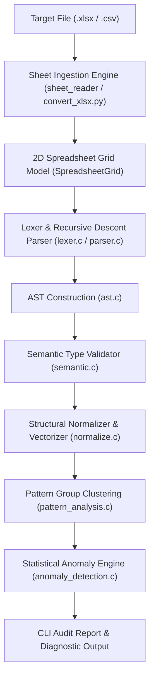

# FormulaGuard: System Architecture & Module Design Document

**FormulaGuard** is a static analysis and structural anomaly detection engine for spreadsheets (Excel `.xlsx` and CSV formats). It parses spreadsheet formulas, converts them into canonical abstract syntax representations with relative coordinate vectors, clusters equivalent formula structures, and detects potential formula errors using statistical dominance rules.

---

## 1. High-Level Architecture & Pipeline Flow

The FormulaGuard audit pipeline operates in six sequential stages:

---

## 2. Core Modules & Responsibilities

The codebase is organized into modular C99 components, located in `src/`:

| Module | Source Files | Primary Responsibility |
| :--- | :--- | :--- |
| **Ingestion Engine** | `sheet_reader.c`, `sheet_reader.h`, `convert_xlsx.py` | Unzips `.xlsx` OpenXML packages, extracts formulas and shared master cells, parses cell coordinates, and builds the in-memory 2D spreadsheet grid. |
| **Lexical Analyzer** | `lexer.c`, `lexer.h` | Tokenizes formula strings into tokens (identifiers, cell references, ranges, operators, numbers, strings). |
| **Syntactic Parser** | `parser.c`, `parser.h` | Implements precedence climbing / recursive descent parsing to transform token streams into Abstract Syntax Trees (AST). |
| **AST Representation** | `ast.c`, `ast.h` | Manages node allocation, tree linking, cloning, and recursive deallocation. |
| **Semantic Validator** | `semantic.c`, `semantic.h` | Enforces type rules (numbers vs ranges vs booleans) and validates argument counts for supported Excel functions. |
| **Structural Normalizer** | `normalize.c`, `normalize.h` | Converts host-dependent cell coordinates into relative vector displacements (`REL[dCol, dRow]`) and produces canonical formula signatures. |
| **Pattern Clustering** | `pattern_analysis.c`, `pattern_analysis.h` | Groups formulas within rows or columns by canonical pattern equivalence. |
| **Anomaly Detector** | `anomaly_detection.c`, `anomaly_detection.h` | Evaluates regional baseline dominance vs outlier shares, generates repair recommendations, and assigns confidence scores. |
| **CLI Driver & Orchestrator** | `main.c` | Coordinates vertical (column-wise) and horizontal (row-wise) audits, calculates overall sheet integrity scores, and renders formatted reports. |

---

## 3. Detailed Module Breakdown

### 3.1 Sheet Ingestion (`sheet_reader.c` & `convert_xlsx.py`)
- **OpenXML / Shared Formula Handling**:
  - In Excel files (`.xlsx`), formulas dragged down a column often use shared formula nodes (`<f t="shared" si="0">`). Excel stores the formula text only in the master cell; slave cells have an empty `<f>` tag.
  - `convert_xlsx.py` parses `xl/worksheets/sheet1.xml` and `xl/sharedStrings.xml`, computes column and row offsets, expands shared formulas into full standard formulas, and provides a clean tabular representation.
- **`SpreadsheetGrid` Structure**:
  - Dynamically stores parsed cells with their `cellAddr` (e.g., `D11`), raw text, and formula flags (`isFormula = 1`).

---

### 3.2 Lexer & AST Parser (`lexer.c`, `parser.c`, `ast.c`)
- **Lexical Analysis**:
  - Recognizes relative and absolute cell coordinates (`A1`, `$A$1`, `A$1`, `$A1`).
  - Distinguishes function invocations (`SUM(`, `IF(`, `COUNT(`) from standard cell labels.
  - Tokenizes binary operators (`+`, `-`, `*`, `/`), comparisons (`=`, `<>`, `<`, `>`, `<=`, `>=`), and range delimiters (`:`).
- **Parser Operator Precedence Hierarchy**:
  1. Primary: Cell references, numeric constants, parenthesized sub-expressions, function calls.
  2. Range: Colon operator `:` (e.g., `A1:B10`).
  3. Multiplicative: `*`, `/`.
  4. Additive: `+`, `-`.
  5. Relational Comparisons: `=`, `<>`, `<`, `<=`, `>`, `>=`.

---

### 3.3 Semantic Type Analysis (`semantic.c`)
Before normalizing, formulas pass through a semantic typing pass to catch syntax errors and unsupported functions.

**Supported Excel Functions**:
1. **Aggregations**: `SUM`, `COUNT`, `COUNTA`, `PRODUCT`, `MAX`, `MIN`, `AVERAGE`
   - *Type Rule*: Arguments must be `SEM_NUMBER`, `SEM_CELL`, or `SEM_RANGE`. Produces `SEM_NUMBER`.
2. **Mathematical Helpers**: `ABS` (1 scalar argument), `ROUND` (2 arguments: value, digits).
   - *Type Rule*: Produces `SEM_NUMBER`.
3. **Conditionals**: `IF` (3 arguments: condition, true_value, false_value).
   - *Type Rule*: Condition must evaluate to `SEM_BOOLEAN`. Both branches must produce scalar values.

---

### 3.4 Coordinate Normalization & Vectorization (`normalize.c`)
The normalizer removes host cell position dependencies by converting coordinates into relative vectors:

$$\Delta\text{Col} = \text{TargetCol} - \text{BaseCol}, \quad \Delta\text{Row} = \text{TargetRow} - \text{BaseRow}$$

#### Examples:
1. **Column-wise formula repetition**:
   - In cell `F1`: `=SUM(A1:E1)` $\longrightarrow$ `SUM(RANGE(REL[-5,0], REL[-1,0]))`
   - In cell `F2`: `=SUM(A2:E2)` $\longrightarrow$ `SUM(RANGE(REL[-5,0], REL[-1,0]))`
   - Both produce the **exact same canonical pattern**, proving structural equivalence!
2. **Absolute vs Relative References**:
   - Absolute components (`$`) are preserved explicitly: `$A$1` $\longrightarrow$ `ABS_CELL($A$1)`.

---

### 3.5 Anomaly Detection Engine (`anomaly_detection.c`)
Evaluates collections of pattern groups within each continuous row or column region.

#### Detection Rules:
1. **Minimum Region Size (`minRegionSize`)**:
   - Default: At least 3 or 4 formulas are required to establish an audit baseline.
2. **Dominance Threshold (`dominantFrequencyThreshold`)**:
   - The #1 pattern must account for $\ge 60\%$ of total formulas in that region. If not, or if two patterns are tied, status is `REGION_NO_DOMINANT_PATTERN` (contested / coexisting).
3. **Outlier Flagging Rules**:
   - **Isolated Singletons**: Any pattern appearing only $\le 1$ time (`outlierMaxCount = 1`) against a dominant pattern is flagged.
   - **Dominant Baseline Outlier Rule**: If the dominant pattern holds $\ge 75\%$ regional share, minority clusters representing $\le 25\%$ share (e.g. 8 vs 2 in a 10-cell series) are flagged as `[OUTLIER]` anomalies.
4. **Repair Suggestions**:
   - Synthesizes expected formulas based on the dominant group's AST and adapts them to the flagged cell's coordinates.

---

## 4. How the Modules Work Together (Execution Walkthrough)

When executing `.\run.ps1 "tests\Book1.xlsx"`:

1. **`run.ps1`** invokes GCC to ensure `formulaguard.exe` is up-to-date.
2. `formulaguard.exe` runs `convert_xlsx.py` to extract sheet data into an intermediate CSV.
3. `sheet_reader.c` loads cells into `SpreadsheetGrid`.
4. `main.c` loops through every column (Vertical Audit):
   - For Column F (10 formulas):
     - Parses `F1`–`F8` $\to$ `SUM(RANGE(REL[-5,0], REL[-1,0]))` (Count: 8, 80%)
     - Parses `F9`–`F10` $\to$ `COUNT(RANGE(REL[-5,0], REL[-1,0]))` (Count: 2, 20%)
     - `anomaly_detection.c` verifies $80\% \ge 75\%$ and $20\% \le 25\% \implies$ Flags `F9` and `F10` as `[OUTLIER]` anomalies.
5. `main.c` loops through every row (Horizontal Audit):
   - For Row 11 (5 formulas):
     - `A11`–`C11` $\to$ 3 `SUM` ($60\%$)
     - `D11` $\to$ 1 `MAX` ($20\%$, flagged as `[OUTLIER]`)
     - `E11` $\to$ 1 `COUNT` ($20\%$, flagged as `[OUTLIER]`)
6. `main.c` computes sheet formula integrity ($73.3\%$) and prints the **Executive Audit Summary**.
